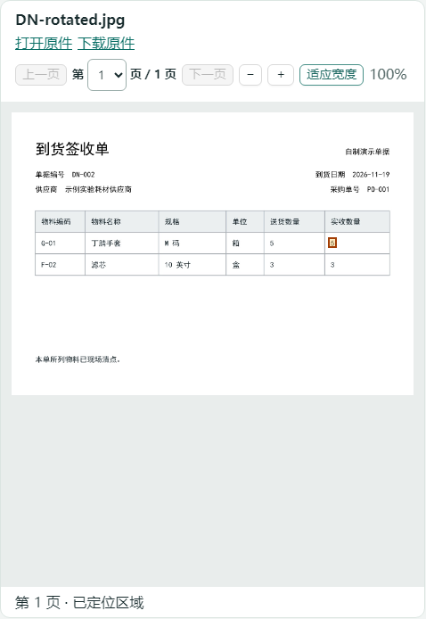

# 阶段四验收记录

2026-11-18 · JDK 21、MySQL 8.4、Microsoft Edge

## 真实 Worker 和浏览器联调

独立测试库 `labreview_test`，采购单 `PO-P4-bb4b9bcc-ae84-4132-a17a-044150b5351e`（ID 113）。Worker 通过 PaddleOCR 读出 DN-001 的短收批注，通过 PDF 文字层解析 DN-002。浏览器测试从订单材料列表进入核对，点选原件证据，保存离开后恢复草稿两次，分别确认入账，再从 G-01 的累计已收打开历史记录。

| 观察点 | G-01 丁腈手套已收 / 待收 | F-02 滤芯已收 / 待收 |
| --- | --- | --- |
| 核对前 | 0 / 10 箱 | 0 / 5 盒 |
| DN-001 草稿保存后 | 0 / 10 箱 | 0 / 5 盒 |
| DN-001 确认后 | 5 / 5 箱 | 0 / 5 盒 |
| DN-002 草稿保存后 | 5 / 5 箱 | 0 / 5 盒 |
| DN-002 确认后 | 10 / 0 箱 | 3 / 2 盒 |

| 单据 | 任务 | 核对记录 | 收货记录 | 核对结果 |
| --- | --- | --- | --- | --- |
| DN-001.jpg | 79 | 5 | 58 | G-01 送 6、实收 5 箱。确认人为 `receiver`，理由记录了手写实收 5 箱、短 1 箱。 |
| DN-002.pdf | 82 | 6 | 59 | G-01 送 5、实收 5 箱。F-02 送 3、实收 3 盒。 |

在连接本次测试库的工作台上，可访问 `/orders/113/receipts/58` 查看 DN-001，并从「来源行与最终值」展开证据，跳回手写实收所在的原件区域。

## 固定结果和回归

| 验证 | 结果 |
| --- | --- |
| `server/.\mvnw.cmd -o test` | 26 项通过。验证 V1 至 V4 空库迁移、V3 原位升级，以及跨订单隔离、版本冲突、空值和零值、无入账结案、多页汇总、并发确认、最新余量与绑定失败回滚。 |
| `web/npm run build` | 通过。PDF.js 与兼容 Worker 由 Vite 打包到本地资源。 |
| `web/npm run test:e2e -- --workers=2` | 11 项通过。固定候选覆盖 5/6 的裁决和恢复、未核失败页、送货量与空实收、明确零值、规格及单位不一致、旋转照片和 PDF 的缩放定位。包含原有手工收货、采购导入和签收详情用例。 |

真实联调使用 PaddleOCR 与 PDF 文字层。豆包真实调用本轮未运行。

## 旋转照片证据

`DN-rotated.jpg` 在浏览器按照片方向显示。高亮标记覆盖手套行的实收数字 5。自动验证了放大、调整窗口宽度、恢复适应宽度后的位置，以及页级证据只翻页的行为。

